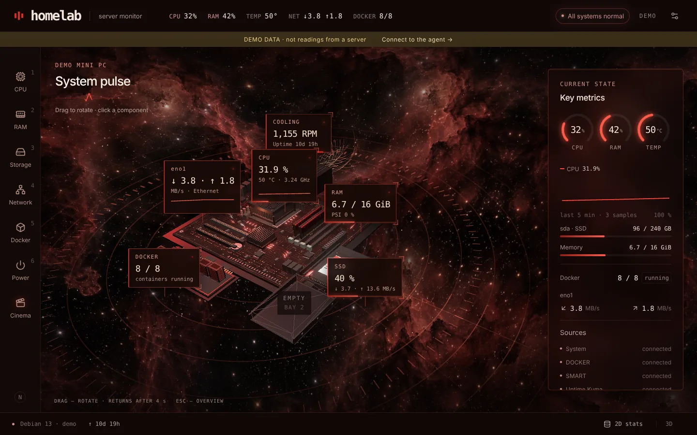
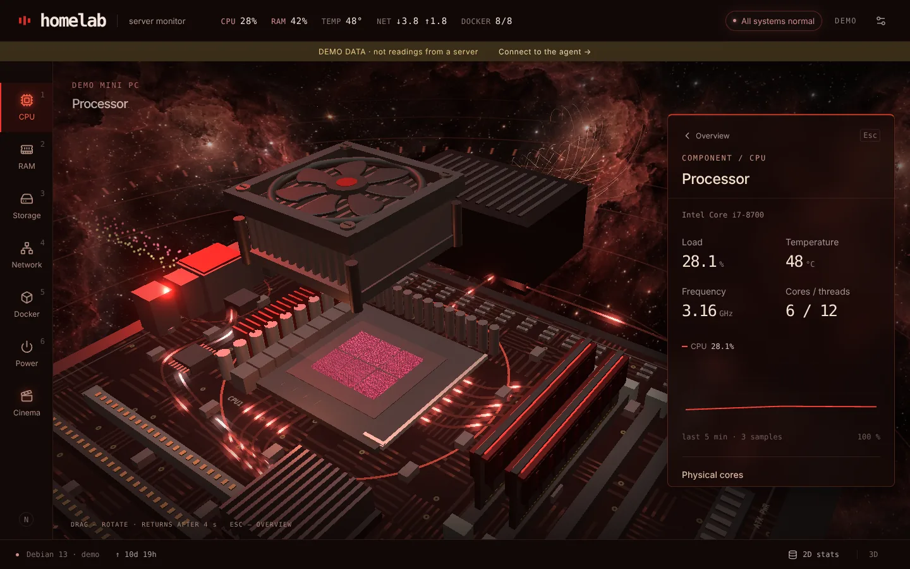
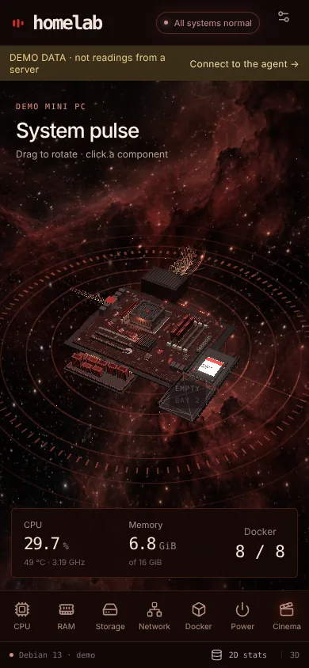

# centre

A live 3D model of your home server. CPU, RAM, drives, network and every Docker container are drawn on a motherboard, and each part moves with real telemetry: traces pulse with CPU load, the cooler spins with temperature, drives light up on I/O, containers grow with their memory use.

One host, no database, no accounts. Two small containers.



| Component focus | Phone |
| --- | --- |
|  |  |

## Quick start

You need Docker with Compose v2 on a Linux host (x86-64 or ARM64).

```bash
mkdir centre && cd centre
curl -fsSLO https://raw.githubusercontent.com/meAlfred/centre-3d-panel/main/compose.yaml
docker compose up -d
```

Open `http://<server-ip>:9110`.

The agent detects the hardware by itself: CPU model and cores, DIMM slots, every SATA/NVMe/USB disk with SMART, network interfaces, temperatures, fans and all containers. Anything the host doesn't expose is shown as "unknown", never as a made-up zero.

Want to try it without installing? Open any running instance with `?mock=1` for demo data.

## Configuration

Everything is optional. Copy `.env.example` to `.env` next to `compose.yaml` and edit it:

| Variable | Default | What it does |
| --- | --- | --- |
| `LISTEN_ADDRESS` | `0.0.0.0` | Interface for the web UI. Set a single IP (LAN or Tailscale) to restrict access. |
| `WEB_PORT` | `9110` | Web UI port. |
| `AGENT_PORT` | `9108` | Internal agent port, loopback only. |
| `HOST_NAME` | host's `/etc/hostname` | Name in the header. |
| `PUBLIC_HOST` | address in the browser | Host used for "open" links on container ports. |
| `KUMA_METRICS_URL`, `KUMA_API_KEY` | empty | Uptime Kuma `/metrics` URL and API key. `KUMA_USERNAME` / `KUMA_PASSWORD` for older versions. |
| `CENTRE_VERSION` | `latest` | Image tag. |

Then `docker compose up -d` again.

### Drive bays (optional)

By default the scene shows the drives that exist. To also draw empty bays, or to pin drives to fixed positions, create `config/host.json` (see `config/host.example.json`). `disk_identity` is the drive's WWID from `/sys/class/block/<disk>/device/wwid`; `null` means an empty bay. The same file can override `hostname`, `model` and the `directory_roots` scanned for the "large directories" list.

### Intel iGPU load (optional, x86 only)

```bash
docker compose -f compose.yaml -f compose.igpu.yaml up -d
```

## Security

The dashboard has **no login**. It shows process names, container names and ports, so don't expose it to the internet. Keep it on your LAN, bind it to a Tailscale/WireGuard IP with `LISTEN_ADDRESS`, or put it behind a reverse proxy with authentication.

What the agent gets from the host, all read-only:

| Mount / capability | Why |
| --- | --- |
| `/proc`, `/sys`, `/` | CPU, memory, PSI, network, file systems, temperatures |
| `/sys/firmware` | RAM slot layout from the SMBIOS table |
| `/dev` + `device_cgroup_rules` (read) | `smartctl` on whole disks; new drives are picked up without editing compose |
| `SYS_RAWIO`, `SYS_ADMIN` | SMART on SATA and NVMe. Drop `SYS_ADMIN` if you have no NVMe drives |
| `DAC_READ_SEARCH` | directory sizes |
| `docker.sock` | container list and stats |

Both containers run with a read-only root filesystem, `no-new-privileges` and all other capabilities dropped. The web container runs as an unprivileged user.

Even read-only, `docker.sock` is effectively root on the host. If you'd rather not hand it over, run [docker-socket-proxy](https://github.com/Tecnativa/docker-socket-proxy) with `CONTAINERS=1` and point the agent at it:

```yaml
# compose.override.yaml
services:
  agent:
    environment:
      DOCKER_HOST: tcp://127.0.0.1:2375
    volumes: !override
      - /proc:/host/proc:ro
      - /sys:/sys:ro
      - /sys/firmware:/host/firmware:ro
      - /:/host/root:ro,rslave
      - /dev:/host/dev:ro
      - ./config:/config:ro
  socket-proxy:
    image: tecnativa/docker-socket-proxy
    environment: {CONTAINERS: 1}
    volumes: [/var/run/docker.sock:/var/run/docker.sock:ro]
    ports: ["127.0.0.1:2375:2375"]
```

## HTTPS and the phone gyroscope

On a phone the scene can follow the device tilt. Browsers only allow motion sensors over HTTPS, so open the dashboard through any HTTPS reverse proxy (Caddy, Traefik, Nginx Proxy Manager) or with Tailscale:

```bash
sudo tailscale serve --bg --https=443 http://127.0.0.1:9110
```

Then enable it under the settings icon → "Enable gyroscope".

## Using it

| Action | How |
| --- | --- |
| Focus a component | Click it, its label, or the side nav |
| CPU / RAM / storage / network / Docker / power | `1`–`6` |
| Back to overview | `Esc` or click the background |
| Rotate | Drag. It returns to the default angle after 4 s |
| 2D stats view | Button in the footer, or `?view=2d` |
| Cinematic fly-through | "Cinema" in the nav, or 30 s without input |
| Share a focused view | URL hash, e.g. `/#cpu`, `/#disk:sda` |
| Demo data | `?mock=1` |

Slow devices drop to a lighter 3D mode automatically, and to the 2D view if WebGL2 is missing or the frame rate stays low.

## How it works

- **agent**: Python 3.12, FastAPI, psutil, Docker SDK, smartctl. Reads the host through read-only mounts and streams snapshots over SSE.
- **web**: React, TypeScript, three.js (React Three Fiber), Zustand, served by nginx. All assets are local; nothing is loaded from a CDN.

When nobody has the page open, the agent stops collecting. A hidden browser tab closes its stream, and the last viewer leaving puts every collector to sleep, including SMART and `du`. `/healthz` never wakes it, so it is safe for Uptime Kuma checks.

Honest data rules: `null` means "not measured" and is displayed as `—`. A fan without an RPM sensor spins at an estimate labelled as such. DIMM modules are drawn from the SMBIOS table; if the layout is unknown, the modules are placeholders and the panel says so.

### API

| Endpoint | |
| --- | --- |
| `GET /api/metrics` | One snapshot (wakes the agent) |
| `GET /api/stream` | SSE, events `metrics` and `status` |
| `GET /api/schema` | JSON Schema of a snapshot, also in `api.schema.json` |
| `GET /api/docs` | OpenAPI UI |
| `GET /healthz` | Health, does not wake collectors |

## Development

```bash
# agent
python3 -m venv .venv && .venv/bin/pip install -r requirements-dev.txt
.venv/bin/python -m pytest -q

# frontend (proxies /api to 127.0.0.1:9108)
cd frontend && npm ci && npm test && npm run dev
```

Build both images from source:

```bash
docker compose -f compose.yaml -f compose.build.yaml up -d --build
```

Running the agent directly on a host for testing:

```bash
HOST_PROC=/proc HOST_ROOT=/ HOST_DEV=/dev HOST_FIRMWARE=/sys/firmware .venv/bin/python -m agent
```

## Supported hardware

Tested on Debian 13 with an Intel desktop board. The detection paths also cover AMD (`k10temp`), Raspberry Pi and other ARM boards (device-tree model, `cpu_thermal`), and VMs (virtio disks, no SMART). Reports from other machines are welcome: please attach the output of `curl localhost:9108/api/metrics` with anything private removed.

Known limits: one host per dashboard; no ZFS pool view (mdraid only); power draw in watts is not measured; the motherboard is a schematic model with four DIMM sockets, so boards with more slots show the first four populated ones.

## Credits

Service icons: [Simple Icons](https://github.com/simple-icons/simple-icons) (CC0) and [Lucide](https://lucide.dev/) (ISC); licenses are in `frontend/public/icons/`. The nebula background is AI-generated artwork made for this project.

## License

Copyright (C) 2026 Alfred (meAlfred)

centre is free software: you can redistribute it and/or modify it under the terms of the [GNU General Public License](LICENSE) as published by the Free Software Foundation, either version 3 of the License, or (at your option) any later version. It is distributed WITHOUT ANY WARRANTY; see the license for details.
